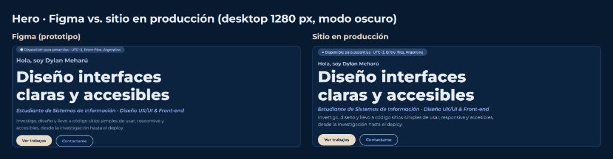
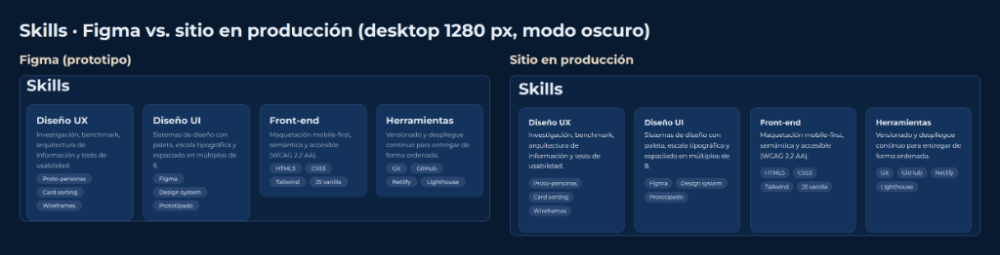
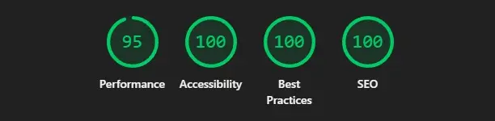

# Portfolio Web Personal · Dylan Meharú

**Trabajo Final de Cátedra — Diseño UX-UI (2026)**  
*Licenciatura en Sistemas de Información — Facultad de Ciencia y Tecnología (FCyT · UADER)*  
**Docente:** Mg. Ernesto Ledesma · **Estudiante:** Dylan Meharú

---

## 📌 Enlaces del Proyecto

- 🌐 **Sitio web desplegado:** [portfolio-dylangmeharu.netlify.app](https://portfolio-dylangmeharu.netlify.app/)
- 🎨 **Archivo de Figma (research, wireframes, design system y prototipo):** [Ver en Figma](https://www.figma.com/design/i3gSAc9BGZpTITtgHVvRyM/Portfolio-Dylan-Mehar%C3%BA-%E2%80%93-Trabajo-Final-UX-UI?node-id=17-18&t=4sfGgyxOED5d3ulN-1)
- 💻 **Repositorio de GitHub:** [github.com/meharudylan/Portfolio](https://github.com/meharudylan/Portfolio)

---

## 🎯 Resumen

Sitio web *one-page* maquetado de forma estática con **HTML5 semántico**, **CSS3** (Grid, Flexbox, variables) y **JavaScript vanilla**, sin frameworks.

- **Mobile-first:** diseñado para 375 px y escalado a 768 px y 1280 px.
- **Accesibilidad (WCAG 2.2 AA):** navegación por teclado con foco visible, enlace "Saltar al contenido", `aria-expanded` y `aria-controls` en el menú, y soporte para `prefers-reduced-motion`.
- **Modo claro y oscuro:** respeta la preferencia del sistema (`prefers-color-scheme`) y permite cambiarla con un botón; la elección se guarda en `localStorage`.
- **Sin dependencias pesadas:** ningún framework JS.

---

## 🎨 Concepto visual

Tres palabras clave definen la marca personal: **claro, confiable, preciso**.

| Palabra | Color | Tipografía | Imágenes |
|---|---|---|---|
| **Claro** | Contraste alto entre azul marino y blanco | Montserrat con jerarquía simple | Mockups limpios y mucho espacio en blanco |
| **Confiable** | Azul marino `#0C2340` como base | Pesos Bold para títulos y Regular para el texto | Capturas reales de mis proyectos |
| **Preciso** | Un solo acento para las acciones (beige `#E8DCC8` en modo oscuro) | Escala fija y espaciado en múltiplos de 8 | Alineadas a una grilla y optimizadas |

**Qué tomé de mis referencias (moodboard en Figma):** de la fotografía del velero, el azul marino sobre tonos claros y la calma de una composición con aire; de la paleta azul, beige y dorado, la idea de un azul profundo con un acento cálido (tomé el beige y descarté el dorado); de Montserrat, su geometría simple y sus variantes (bold e italic) para dar jerarquía; del portfolio y del dashboard, el orden visual y el espacio en blanco; de la interfaz con acento violeta, el equilibrio entre los elementos, sin copiar sus colores.

---

## 🔍 Research y proceso UX

**Usuario objetivo (proto-persona):** Lucía, reclutadora IT, revisa unos 20 portfolios por semana, muchas veces desde el celular. Necesita saber en menos de 30 segundos quién soy, qué sé hacer y ver un caso real.

**Las 3 preguntas de research:**
1. ¿Qué es lo primero que buscás cuando entrás al portfolio de alguien que querés contratar?
2. ¿Cuánto tiempo mirás un portfolio antes de decidir si seguís o te vas?
3. ¿Qué te hace desconfiar o abandonar un portfolio?

**Benchmark de 3 portfolios:**

| Portfolio | Qué funciona | Qué no funciona | Qué me llevo |
|---|---|---|---|
| Ernesto Ledesma | Estructura de 9 secciones, anclas, métricas y resultados medibles | Proyectos sin caso de estudio, links sociales genéricos y sin `og:image` | La arquitectura de información |
| David Estrada | Un caso de estudio por proyecto, testimonios y un CTA claro | Depende de un solo canal de contacto y no tiene línea de tiempo | Caso de estudio por proyecto |
| Josué Pichot | Skip link, filtros de trabajos y metadatos completos | 18 trabajos y mucho texto repetido; publica teléfono y dirección | Skip link y metadatos completos |

**Test de usabilidad (3 participantes, sobre el prototipo de Figma):**

| Tarea | Participante 1 (celular) | Participante 2 (compu) | Participante 3 (compu) |
|---|:---:|:---:|:---:|
| Encontrar el email de contacto | Sí · 3 s | Sí · 5 s | Sí · 4 s |
| Abrir el proyecto más reciente | Sí · 8 s | Sí · 6 s | Sí · 7 s |
| Nombrar una herramienta de diseño | Sí · 10 s | Sí · 5 s | Sí · 8 s |

- **Hallazgo:** dos participantes dudaron al identificar cuál era el proyecto más reciente.
- **Cambio aplicado:** se agregó la etiqueta "Más reciente" en la primera tarjeta y una línea que aclara el orden de los proyectos.
- **Comentarios:** destacaron la sencillez, el orden y la facilidad para navegar; ninguno reportó confusiones importantes.

### Evidencias del proceso en Figma

| Wireframes (baja fidelidad) | Design System y tokens |
|:---:|:---:|
|  |  |

| Arquitectura de información | Componentes maestros |
|:---:|:---:|
|  |  |

> 📁 Los frames exportados se encuentran en [`assets/docs/figma/`](assets/docs/figma/).

---

## 🔍 Fidelidad de implementación (Figma vs. sitio web)

### Comparación en desktop (1280 px, modo oscuro)





---

## 💼 Proyectos y casos de estudio

| Proyecto | Tipo | Stack | Demo / Repositorio |
|---|---|---|---|
| **Este portfolio** | Proyecto final integrador | Figma · HTML5 · CSS3 · JS vanilla | [Ver demo](https://portfolio-dylangmeharu.netlify.app/) · [Repo](https://github.com/meharudylan/Portfolio) |
| **Cubrí Seguros** | Caso de estudio UX/UI | Checkout en pasos · Tailwind v4 · Basecoat UI | [Ver demo](https://seguroscubri.netlify.app/) · Modal en el sitio |
| **Coffea** | Landing page de cafetería | Figma a código · HTML5 · CSS3 | [Ver demo](https://coffea-landing.netlify.app/) · Modal en el sitio |

---

## 📊 Auditoría de rendimiento (Lighthouse, mobile)

<p align="center">
  
</p>

| Métrica | Puntaje | Requisito | Estado |
|---|:---:|:---:|:---:|
| ⚡ Performance | **95 / 100** | ≥ 90 | Superado |
| ♿ Accessibility | **100 / 100** | ≥ 90 | Óptimo |
| 🛡️ Best Practices | **100 / 100** | ≥ 90 | Óptimo |
| 🔍 SEO | **100 / 100** | ≥ 90 | Óptimo |

> 📄 El reporte completo está en [`assets/docs/lighthouse.html`](assets/docs/lighthouse.html).

---

## 🛠️ Stack y fuentes

- **Estructura:** HTML5 semántico (`header`, `nav`, `main`, `section`, `article`, `dialog`, `footer`).
- **Estilos:** CSS3 con variables (`:root`), Flexbox y CSS Grid.
- **Tipografía:** [Montserrat](https://fonts.google.com/specimen/Montserrat) (Google Fonts, `font-display: swap`).
- **Imágenes:** WebP con `width`, `height` y `loading="lazy"`; imagen Open Graph de 1200×630.
- **Plantillas:** ninguna. El diseño visual es propio.
- **Inspiración:** los portfolios de Ernesto Ledesma, David Estrada y Josué Pichot (benchmark) y el moodboard documentado en Figma.

---

## 🤖 Uso de inteligencia artificial

Conforme a la política de la cátedra, declaro qué se generó con IA y cómo lo revisé:

- **Claude (Anthropic):** asistió en la estructura del archivo de Figma (design system, wireframes y prototipo), en el código base HTML/CSS/JS, en borradores de textos (benchmark, proto-persona y casos de estudio) y en la guía de Git y de entrega.
- **Gemini (Antigravity):** asistió en la integración de imágenes en WebP, en la ejecución de la auditoría Lighthouse y en un primer borrador del README.
- **Mi autoría y revisión:** definí el concepto (palabras clave, moodboard, paleta azul y beige, Montserrat), elegí los referentes, ajusté el contenido y los textos a mi experiencia, hice el test de usabilidad con 3 personas, apliqué sus hallazgos, hice los commits y desplegué el sitio. Revisé y probé en el navegador todo lo generado antes de publicarlo.

---

## 🚀 Despliegue continuo (CI/CD)

Desplegado en **Netlify** desde el repositorio de GitHub:

1. Repositorio vinculado a la rama `main`.
2. Despliegue automático en cada `push`.
3. Configuración: *Build command:* ninguno (sitio estático) · *Publish directory:* `.` (raíz).
4. Página 404 personalizada en [`404.html`](404.html).

---

## 💻 Ejecución local

```bash
git clone https://github.com/meharudylan/Portfolio.git
cd Portfolio
# Abrir index.html en un navegador
```

---

## 📬 Contacto

**Dylan Meharú** · Estudiante de Lic. en Sistemas de Información (UADER · FCyT) · Concepción del Uruguay, Entre Ríos, Argentina  
- ✉️ [dylan.g.meharu@gmail.com](mailto:dylan.g.meharu@gmail.com)  
- 💼 [LinkedIn](https://www.linkedin.com/in/dylan-meharu-67aa97449/)  
- 🐙 [GitHub](https://github.com/meharudylan)
