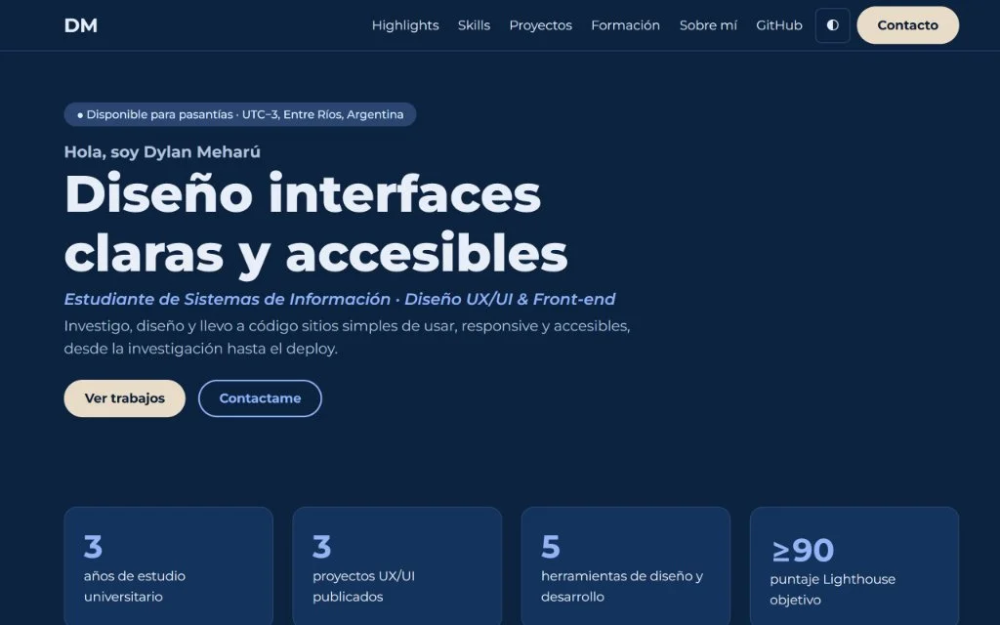
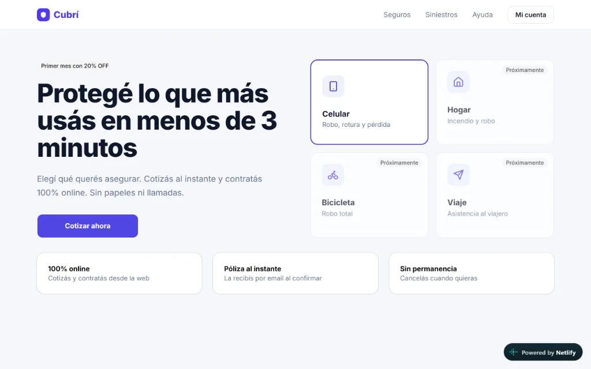
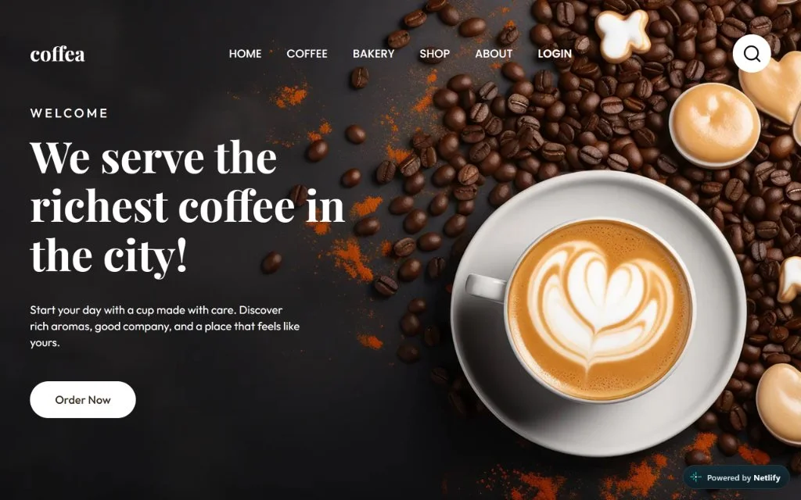

# Portfolio · Dylan Meharú

> Sitio one-page diseñado en Figma y maquetado en HTML5, CSS3 y JavaScript vanilla. Responsive, accesible (WCAG 2.2 AA) y con modo oscuro/claro.

- **Sitio live:** [portfolio-dylangmeharu.netlify.app](https://portfolio-dylangmeharu.netlify.app/)
- **Figma:** [Ver research, wireframes, design system y prototipo](https://www.figma.com/design/i3gSAc9BGZpTITtgHVvRyM/Portfolio-Dylan-Mehar%C3%BA-%E2%80%93-Trabajo-Final-UX-UI?node-id=17-18&t=4sfGgyxOED5d3ulN-1)
- **Stack:** HTML5 · CSS3 (custom properties, Grid, Flexbox) · JavaScript vanilla
- **Tipografía:** Montserrat — Google Fonts
- **Deploy:** Netlify — CD automático desde `main`

---

## Capturas

### Portfolio — hero y highlights


### Cubrí Seguros — caso de estudio


### Coffea — landing page


### Proceso de diseño en Figma

| Wireframes (Baja Fidelidad) | Design System (Figma) |
|---|---|
|  |  |

> Todos los frames exportados en alta resolución se encuentran en [`assets/docs/figma/`](assets/docs/figma/) (Research, Arquitectura, Wireframes, Design System y Prototipos Mobile/Desktop).

### Reporte Lighthouse Mobile
- **Performance:** 98 / 100
- **Accessibility:** 100 / 100
- **Best Practices:** 100 / 100
- **SEO:** 100 / 100

> El reporte interactivo completo generado para mobile se encuentra disponible en [`assets/docs/lighthouse.html`](assets/docs/lighthouse.html).

---

## Proyectos incluidos

| Proyecto | Tipo | Stack | Demo |
|----------|------|-------|------|
| **Este portfolio** | Proyecto final UX/UI | HTML5, CSS3, JS vanilla | [portfolio-dylangmeharu.netlify.app](https://portfolio-dylangmeharu.netlify.app/) |
| **Cubrí Seguros** | Caso de estudio UX/UI | Figma · Tailwind v4 · Basecoat UI · JS | [seguroscubri.netlify.app](https://seguroscubri.netlify.app/) |
| **Coffea** | Landing page | Figma · HTML5 · CSS3 | [coffea-landing.netlify.app](https://coffea-landing.netlify.app/) |

---

## Estructura del sitio

Página única con navegación por anclas. Secciones en orden:

1. **Header** — logo DM, anclas de navegación, toggle modo oscuro/claro, CTA Contacto
2. **Hero** — nombre, rol, propuesta de valor, disponibilidad (UTC−3, Entre Ríos), CTAs
3. **Highlights** — 4 cifras reales: años de estudio, proyectos, herramientas, puntaje Lighthouse
4. **Skills** — UX, UI, Front-end y Herramientas, con chips de tecnologías
5. **Proyectos** — 3 proyectos con imagen, año, descripción, resultado, herramientas y enlaces
6. **Formación** — timeline con período, institución y dos logros por ítem
7. **Sobre mí** — párrafo, foto y tres principios de trabajo
8. **Contacto** — email `mailto:`, LinkedIn y GitHub
9. **Footer** — copyright, navegación repetida y redes sociales

---

## Características técnicas

- **Mobile-first** — probado en 375 px, 768 px y 1280 px sin scroll horizontal
- **Accesibilidad WCAG 2.2 AA** — skip link, `lang="es"`, ARIA labels, `aria-expanded` en menú mobile, `focus-visible`, `prefers-reduced-motion`
- **Modo oscuro/claro** — detecta `prefers-color-scheme`, persiste en `localStorage`
- **Sin frameworks JS** — cero dependencias en producción
- **SEO** — `title`, `meta description`, Open Graph (`og:title`, `og:description`, `og:image`), `theme-color`, favicon SVG inline
- **Imágenes** — WebP optimizado, `width`/`height` declarados, `loading="lazy"` bajo el primer pliegue
- **Lighthouse objetivo ≥ 90** en Performance, Accessibility, Best Practices y SEO

---

## Recursos y fuentes

- **Tipografía:** [Montserrat](https://fonts.google.com/specimen/Montserrat) — Google Fonts (SIL Open Font License)
- **Template:** Ninguno — diseño 100 % original a partir del proceso UX/UI documentado en Figma
- **Imágenes:** capturas propias de los proyectos desarrollados

---

## Uso de IA

Se utilizó asistencia de inteligencia artificial (Antigravity / Gemini) como herramienta de pair programming y soporte técnico en las siguientes tareas:
- Maquetación y verificación de estándares de accesibilidad WCAG 2.2 AA (navegación por teclado, atributos ARIA, contraste).
- Scripting de optimización automatizada de imágenes (conversión a WebP y redimensionado).
- Ejecución y diagnóstico de auditorías automatizadas de Lighthouse CLI.
- Estructuración de la documentación técnica y pasos de despliegue en el README.

La arquitectura de información, el concepto visual, la investigación y los componentes fueron diseñados y prototipados originalmente en Figma.

---

## Despliegue en Netlify

1. Hacer fork o clonar este repositorio en tu cuenta de GitHub.
2. Ir a [netlify.com](https://netlify.com) → **Add new site → Import an existing project**.
3. Conectar con GitHub y seleccionar el repositorio `Portfolio`.
4. Configuración de build:
   - **Base directory:** _(vacío)_
   - **Build command:** _(vacío — sitio estático)_
   - **Publish directory:** `.` _(raíz)_
5. Hacer clic en **Deploy site**.
6. Netlify genera una URL pública con HTTPS. Cada `push` a `main` redespliega automáticamente.
7. Agregar la URL generada al campo **Sitio live** de este README y a la descripción del repositorio en GitHub.

---

## Correr localmente

```bash
git clone https://github.com/meharudylan/Portfolio.git
cd Portfolio
# Abrir index.html directamente en el navegador
# No requiere servidor, build ni dependencias
```

---

## Autor

Dylan Meharú · [dylan.g.meharu@gmail.com](mailto:dylan.g.meharu@gmail.com) · [LinkedIn](https://www.linkedin.com/in/dylan-meharu-67aa97449/) · [GitHub](https://github.com/meharudylan)
