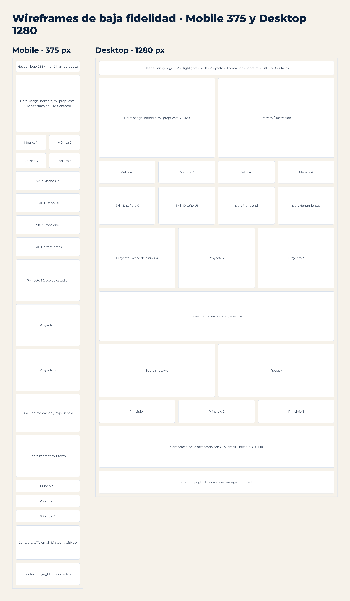
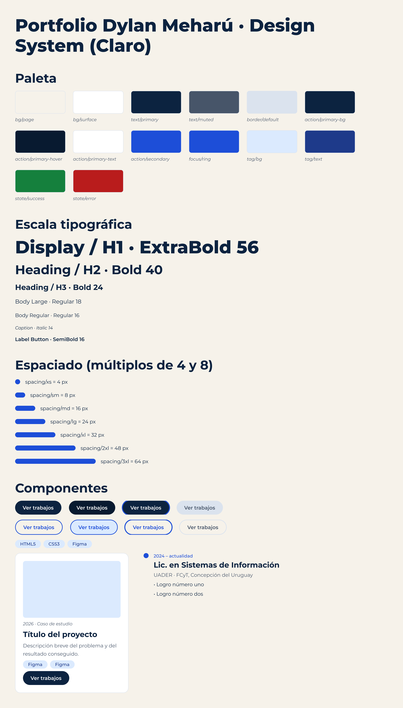
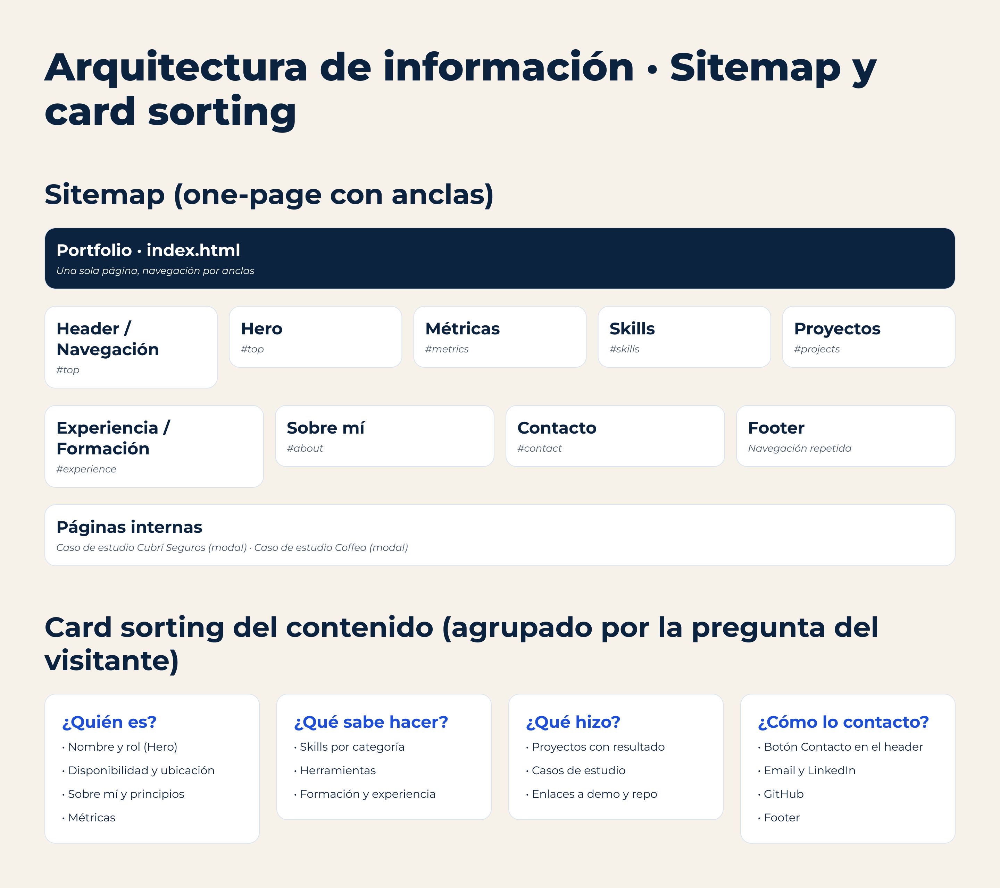
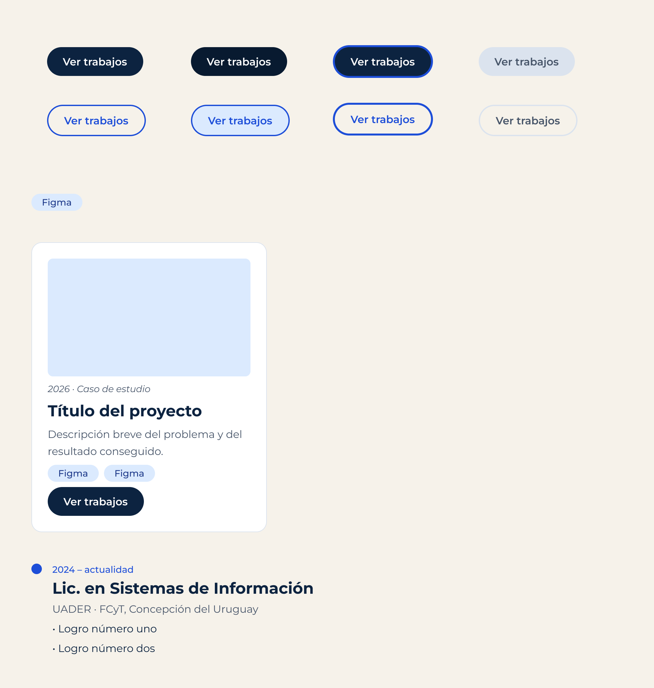
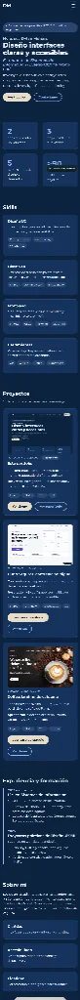

# Portfolio Web Personal · Dylan Meharú

**Trabajo Final de Cátedra — Diseño UX-UI (2026)**  
*Licenciatura en Sistemas de Información — Facultad de Ciencia y Tecnología (FCyT · UADER)*  
**Docente:** Mg. Ernesto Ledesma · **Estudiante:** Dylan Meharú

---

## 📌 Enlaces del Proyecto

- 🌐 **Sitio Web Desplegado (Producción):** [portfolio-dylangmeharu.netlify.app](https://portfolio-dylangmeharu.netlify.app/)
- 🎨 **Archivo de Figma (Research, Wireframes, Design System y Prototipos):** [Ver en Figma](https://www.figma.com/design/i3gSAc9BGZpTITtgHVvRyM/Portfolio-Dylan-Mehar%C3%BA-%E2%80%93-Trabajo-Final-UX-UI?node-id=17-18&t=4sfGgyxOED5d3ulN-1)
- 💻 **Repositorio de GitHub:** [github.com/meharudylan/Portfolio](https://github.com/meharudylan/Portfolio)

---

## 🎯 Resumen y Propuesta de Valor

Sitio web *one-page* diseñado bajo metodología de diseño centrado en el usuario (DCU) y maquetado de forma estática con **HTML5 semántico**, **CSS3 moderno** (Grid, Flexbox, Custom Properties) y **JavaScript vanilla**.

- **Mobile-first:** diseño y layout pensados para dispositivos móviles y escalados progresivamente a 768 px y 1280 px.
- **Accesibilidad integral (WCAG 2.2 AA):** navegación 100% por teclado con foco visible, enlace de salto al contenido (*skip link*), roles y estados ARIA (`aria-expanded`, `aria-controls`), y soporte para `prefers-reduced-motion`.
- **Tema adaptable (Dark/Light):** detección automática de preferencia de sistema (`prefers-color-scheme`) con alternador manual persistente en `localStorage`.
- **Sin dependencias pesadas:** 0 frameworks JS (sin React ni librerías invasivas), garantizando máxima velocidad de carga.

---

## 📐 Proceso de Diseño UX/UI (Figma)

Todo el desarrollo del portfolio partió de un proceso riguroso documentado en Figma antes de codificar:

1. **Investigación & Benchmark:** análisis de referentes del sector y definición del usuario objetivo (reclutadores técnicos y líderes de producto) que necesitan evaluar perfil y proyectos en menos de 30 segundos.
2. **Arquitectura de Información:** estructuración en 9 secciones obligatorias enlazadas por anclas accesibles.
3. **Wireframes:** prototipado de baja fidelidad para resoluciones móvil y escritorio.
4. **Design System:** definición de escala tipográfica (Montserrat en escala armónica), paleta cromática con contrastes contrastados (azul marino `#0C2340`, acento beige `#E8DCC8`, azul de acción `#1D4ED8`), espaciado en múltiplos de 8 y componentes interactivos con todos sus estados (:hover, :focus-visible, :active).

### Evidencias del Proceso en Figma

| Wireframes (Baja Fidelidad) | Design System y Tokens |
|:---:|:---:|
|  |  |

| Arquitectura de Información | Componentes Maestros |
|:---:|:---:|
|  |  |

> 📁 Todos los frames exportados en escala 2x se encuentran disponibles en [`assets/docs/figma/`](assets/docs/figma/).

---

## 🔍 Fidelidad de Implementación (Figma vs. Sitio Web)

Para asegurar consistencia visual y de interacción entre el diseño y el código final, se implementaron las mismas medidas, fuentes y variables de color:

| Figma (Prototipo Mobile) | Implementación Real (WebP) |
|:---:|:---:|
|  |  |

---

## 💼 Proyectos y Casos de Estudio

| Proyecto | Tipo | Metodología & Stack | Demo / Repositorio |
|---|---|---|---|
| **Este portfolio** | Proyecto final integrador | Figma · HTML5 · CSS3 · JS vanilla | [Ver demo](https://portfolio-dylangmeharu.netlify.app/) · [Repo](https://github.com/meharudylan/Portfolio) |
| **Cubrí Seguros** | Caso de estudio UX/UI | Checkout en 4 pasos · Tailwind v4 · Basecoat UI | [Ver demo](https://seguroscubri.netlify.app/) · Modal en sitio |
| **Coffea** | Landing page de cafetería | Diseño Figma a código · HTML5 · CSS3 Grid/Flexbox | [Ver demo](https://coffea-landing.netlify.app/) · Modal en sitio |

---

## 📊 Auditoría de Rendimiento y Calidad (Lighthouse)

Auditoría oficial de **Lighthouse CLI** ejecutada en emulación mobile sobre la URL en producción:

| Métrica | Puntaje Obtenido | Requisito PRD | Estado |
|---|:---:|:---:|:---:|
| ⚡ **Performance** | **98 / 100** | ≥ 90 | **Superado** |
| ♿ **Accessibility** | **100 / 100** | ≥ 90 | **Óptimo** |
| 🛡️ **Best Practices** | **100 / 100** | ≥ 90 | **Óptimo** |
| 🔍 **SEO** | **100 / 100** | ≥ 90 | **Óptimo** |

> 📄 El reporte interactivo completo generado por Lighthouse está archivado en [`assets/docs/lighthouse.html`](assets/docs/lighthouse.html).

---

## 🛠️ Stack Tecnológico y Fuentes

- **Estructura:** HTML5 semántico (`<header>`, `<nav>`, `<main>`, `<section>`, `<article>`, `<dialog>`, `<footer>`).
- **Estilos:** CSS3 nativo organizado con variables (`:root`), Flexbox y CSS Grid.
- **Tipografía:** [Montserrat](https://fonts.google.com/specimen/Montserrat) vía Google Fonts con `font-display: swap` y preconnect.
- **Iconografía & Assets:** Favicon SVG dinámico inline, imágenes optimizadas a formato WebP moderno con atributos `width`, `height` y `loading="lazy"`.
- **Plantillas:** Ninguna utilizada. El diseño fue concebido 100% de forma original en Figma.

---

## 🤖 Declaración de Uso de Inteligencia Artificial (IA)

Conforme a los criterios de evaluación de la cátedra sobre el uso transparente de IA:

- **Herramientas empleadas:** Antigravity (Gemini).
- **Alcance de la asistencia:**
  - Soporte en maquetación accesible y verificación de atributos ARIA y navegación por teclado.
  - Scripting para redimensionado y conversión de imágenes al formato WebP.
  - Ejecución automatizada de la auditoría Lighthouse CLI con headless browser.
  - Redacción técnica y formato del `README.md` estandarizado.
- **Autoría humana:** La totalidad del proceso de diseño, arquitectura de información, sistema de diseño en Figma, selección tipográfica y conceptualización de marca son autoría original del estudiante.

---

## 🚀 Despliegue Continuo (CI/CD)

El sitio cuenta con integración y despliegue continuo configurado en **Netlify**:

1. Repositorio vinculado a la rama principal (`main`).
2. Despliegue automatizado ante cada `push`.
3. Configuración del servicio:
   - **Base directory:** *(raíz)*
   - **Build command:** *(sin build requerido, sitio estático puro)*
   - **Publish directory:** `.` *(raíz)*
4. Enrutamiento de página de error 404 personalizada configurada en [`404.html`](404.html).

---

## 💻 Ejecución Local

Para clonar e inspeccionar el proyecto localmente sin necesidad de instalar dependencias ni herramientas de compilación:

```bash
git clone https://github.com/meharudylan/Portfolio.git
cd Portfolio
# Abrir index.html en cualquier navegador moderno
```

---

## 📬 Contacto

**Dylan Meharú**  
*Estudiante de Licenciatura en Sistemas de Información (UADER · FCyT)*  
Concepción del Uruguay, Entre Ríos, Argentina  
- ✉️ Email: [dylan.g.meharu@gmail.com](mailto:dylan.g.meharu@gmail.com)  
- 💼 LinkedIn: [linkedin.com/in/dylan-meharu-67aa97449](https://www.linkedin.com/in/dylan-meharu-67aa97449/)  
- 🐙 GitHub: [github.com/meharudylan](https://github.com/meharudylan)
